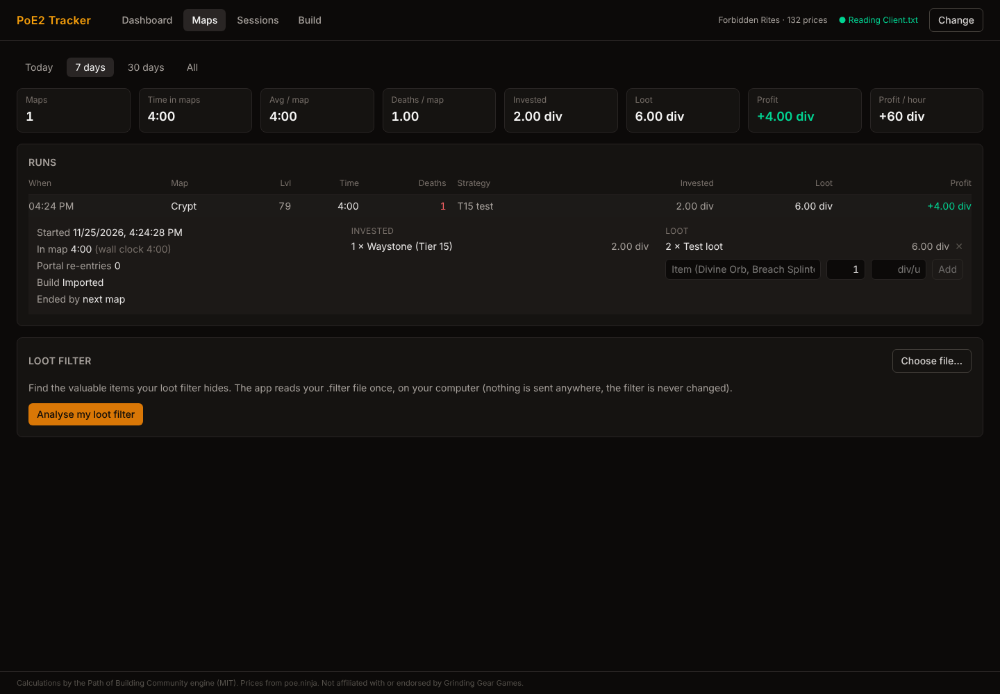
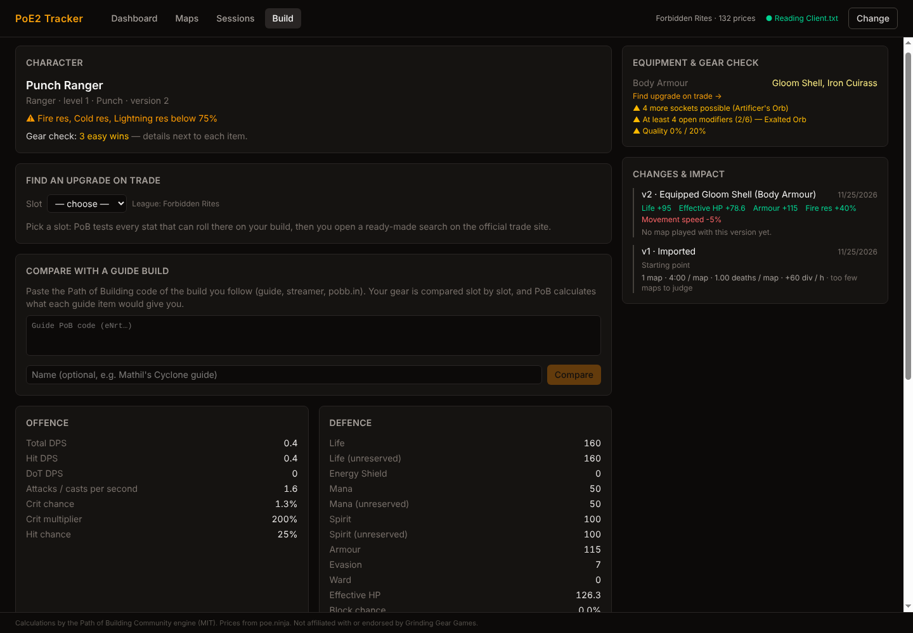

# PoE2 Tracker

Free, open-source, local-first desktop tracker for **Path of Exile 2**.

- **Waystone run tracking** from `Client.txt` — maps per hour, time in maps, deaths, portal re-entries
- **Investment & profit/hour** — prices from poe.ninja, cached locally
- **Build × Performance** — see what a gear or passive change really does. Numbers come from the
  Path of Building engine running invisibly inside the app; you never have to configure PoB yourself

> Work in progress — targeting the Path of Exile 2 1.0 launch (December 11, 2026).


| Maps | Build |
|---|---|
|  |  |

## Status

| Module | State |
|---|---|
| Client.txt watcher + run tracker | ✅ working, tested (patterns to re-check on 1.0 logs) |
| Headless Path of Building bridge | ✅ build import/export, item comparison, node comparison |
| poe.ninja pricing (1 h cache) | ✅ |
| Build versions (every run linked to the active version) | ✅ |
| Item comparison: Ctrl+C on the item in game, then the app shortcut (Ctrl+Shift+C) + "I equipped it" | ✅ |
| Farming strategies (waystone + tablets…) auto-applied to each map, loot entry, profit/hour | ✅ |
| Sessions with a farming mode: rush N maps, pinnacle boss attempts (kill/fail), hideout stash/crafting — real profit/hour over the whole session | ✅ |
| Maps tab: history by period, per-run detail, stats by map | ✅ |
| Build tab: full stat sheet, equipment, every change with its stat diff and its impact on your maps | ✅ |
| Guide build comparison: paste the PoB of the build you follow → stats vs guide, slot-by-slot missing/lower mods, what each guide item would give you (PoB), price of missing uniques; passive tree (keystones/notables to take, rated by PoB) and skill gems (levels, quality, missing supports) | ✅ |
| Trade upgrade search: PoB ranks the stats that help your build most for a slot; force / exclude stats, min values, max price; preview of the gain; opens a pre-filled search on the official trade site (no trade API calls) | ✅ |
| Gear check: empty rune sockets, sockets still possible, open modifiers, missing quality, outdated bases, low item level | ✅ |
| Best next upgrade, trade search for rares, AI explanations | 🚧 |
| Windows installer (built and tested on Windows by GitHub Actions) | ✅ first version |

## Development

Requirements: Node 22+, git, a C compiler and make (for the PoB engine).

```bash
npm install
npm run build:engine   # calculation engine pack: Path of Building (pinned in engine.json) + LuaJIT
npm run dev         # start the app
npm run check       # quick check for every change (~15 s): typecheck, unit tests, smoke test
npm run check:full  # full battery for big changes / releases (~3 min): + engine tests, e2e
npm run dist:win    # Windows installer (on Windows, from a Developer Command Prompt for the engine)
```

Set `POE2_CLIENT_LOG=/path/to/Client.txt` to point the app at a specific log file, and
`POE2_FILTER_DIR` at a folder holding loot filters. Details: [docs/TESTING.md](docs/TESTING.md).

### Layout

```
src/core/      platform-independent logic (log parsing, run tracker, pricing, DB, PoB bridge) — unit tested
src/main/      Electron main process (wiring + IPC)
src/preload/   typed bridge exposed to the UI
src/renderer/  React + Tailwind UI
resources/pob/ bridge.lua — drives the unmodified PoB engine
```

## Privacy

Everything stays on your computer. No account, no telemetry. The optional AI explanations (off by default) only
ever send stat differences, never your logs.

## Credits

Build calculations by the [Path of Building Community](https://github.com/PathOfBuildingCommunity/PathOfBuilding-PoE2)
engine (MIT). Prices from [poe.ninja](https://poe.ninja).

This product isn't affiliated with or endorsed by Grinding Gear Games in any way.

## License

MIT

## Game rules

The app follows GGG's [third-party policy](https://www.pathofexile.com/developer):

- It reads `Client.txt` (the game log) to track maps, and says so in the app.
- It reads the clipboard **once per press of its shortcut**, never in the background, and never sends
  keys to the game.
- It reads your loot filter only after you click "Analyse my loot filter", and never changes it.
- It never calls GGG's trade API or undocumented endpoints, and never reads or modifies game files or memory.

Not affiliated with or endorsed by Grinding Gear Games.

