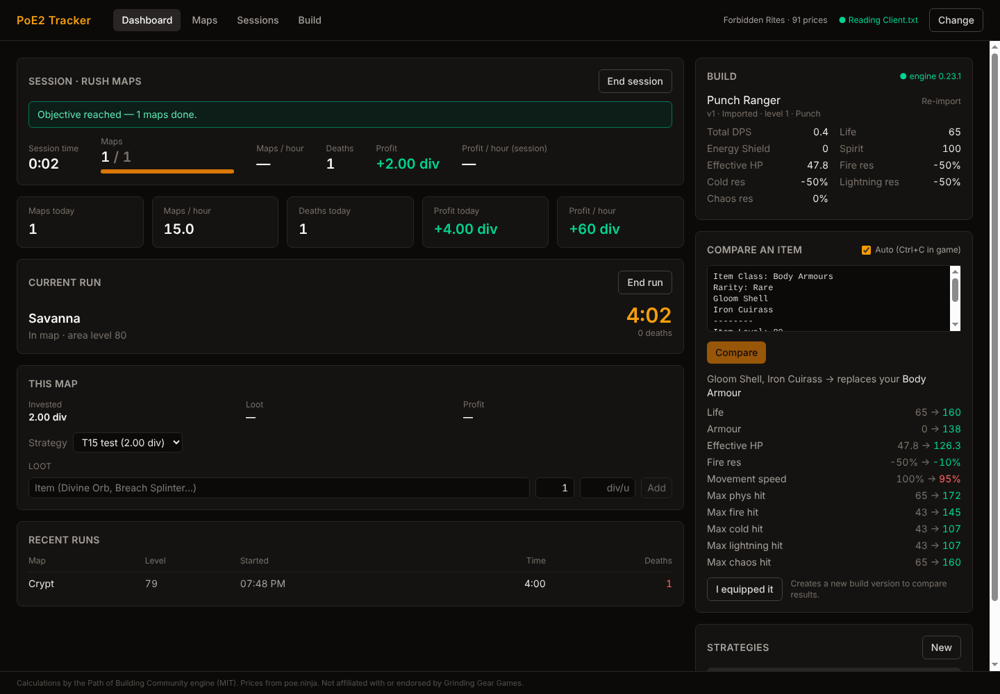

# PoE2 Tracker

Free, open-source, local-first desktop tracker for **Path of Exile 2**.

- **Waystone run tracking** from `Client.txt` — maps per hour, time in maps, deaths, portal re-entries
- **Investment & profit/hour** — prices from poe.ninja, cached locally
- **Build × Performance** — see what a gear or passive change really does. Numbers come from the
  Path of Building engine running invisibly inside the app; you never have to configure PoB yourself

> Work in progress — targeting the Path of Exile 2 1.0 launch (December 11, 2026).



| Maps | Build |
|---|---|
|  |  |

## Status

| Module | State |
|---|---|
| Client.txt watcher + run tracker | ✅ working, tested (patterns to re-check on 1.0 logs) |
| Headless Path of Building bridge | ✅ build import/export, item comparison, node comparison |
| poe.ninja pricing (1 h cache) | ✅ |
| Build versions (every run linked to the active version) | ✅ |
| Ctrl+C item comparison (automatic) + "I equipped it" | ✅ |
| Farming strategies (waystone + tablets…) auto-applied to each map, loot entry, profit/hour | ✅ |
| Sessions with a farming mode: rush N maps, pinnacle boss attempts (kill/fail), hideout stash/crafting — real profit/hour over the whole session | ✅ |
| Maps tab: history by period, per-run detail, stats by map | ✅ |
| Build tab: full stat sheet, equipment, every change with its stat diff and its impact on your maps | ✅ |
| Gear check: empty rune sockets, sockets still possible, open modifiers, missing quality, outdated bases, low item level | ✅ |
| Best next upgrade, trade search for rares, AI explanations | 🚧 |
| Windows installer | 🚧 |

## Development

Requirements: Node 22+, git, a C compiler and make (for the PoB engine).

```bash
npm install
npm run setup:pob   # Path of Building engine (Linux/macOS for now, see docs/pob-engine.md)
npm run dev         # start the app
npm test            # unit tests
npm run test:pob    # integration tests against the real PoB engine
npm run build && npm run test:e2e   # end-to-end smoke test of the built app
```

Set `POE2_CLIENT_LOG=/path/to/Client.txt` to point the app at a specific log file.

### Layout

```
src/core/      platform-independent logic (log parsing, run tracker, pricing, DB, PoB bridge) — unit tested
src/main/      Electron main process (wiring + IPC)
src/preload/   typed bridge exposed to the UI
src/renderer/  React + Tailwind UI
resources/pob/ bridge.lua — drives the unmodified PoB engine
```

## Privacy

Everything stays on your computer. No account, no telemetry. The optional AI explanations (off by default) only
ever send stat differences, never your logs.

## Credits

Build calculations by the [Path of Building Community](https://github.com/PathOfBuildingCommunity/PathOfBuilding-PoE2)
engine (MIT). Prices from [poe.ninja](https://poe.ninja).

This product isn't affiliated with or endorsed by Grinding Gear Games in any way.

## License

MIT
